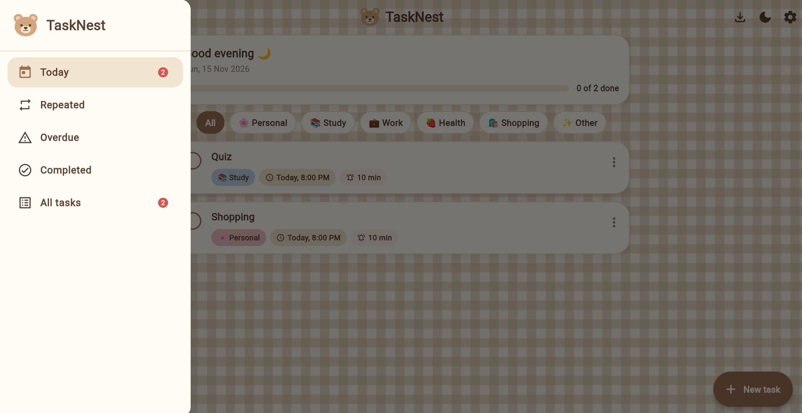
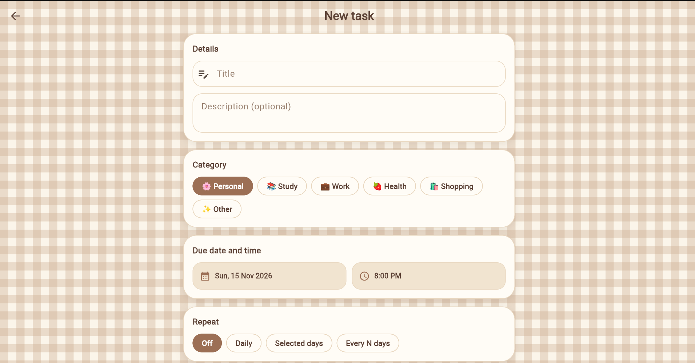
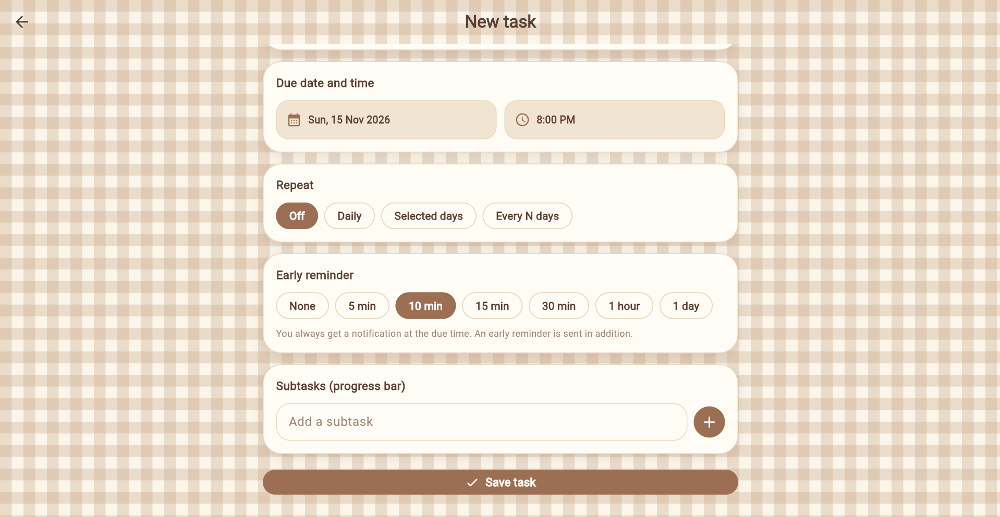
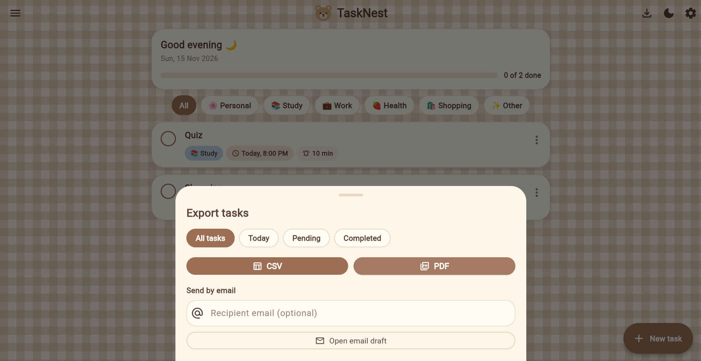
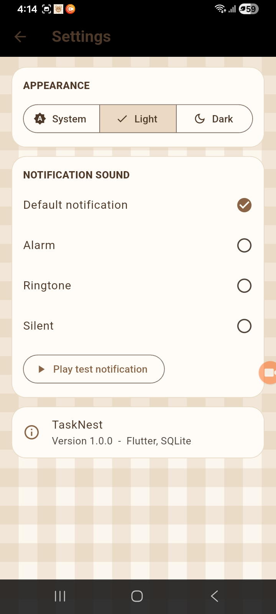

# 🧸 TaskNest

TaskNest is a task management app built with **Flutter** and **SQLite**. Add, edit, delete, categorize and complete tasks, repeat them on a schedule, track progress with subtasks, export your tasks, and get reminders when a task is due. Runs in **Google Chrome**, with an **Android APK** also provided.

| | |
|---|---|
| 🎥 Video demonstration | [Watch the demo video](https://drive.google.com/file/d/1PXDL6R2nLqUiPuBFJXC4WXsp2khpMkYg/view?usp=sharing) |
| 📦 Android APK | [Download app-release.apk](https://github.com/kashafx007/task-manager-app/blob/main/apk/app-release.apk) |

---

## Screenshots

<table>
  <tr>
    <td width="50%"><br><b>Today</b></td>
    <td width="50%"><br><b>Side menu</b></td>
  </tr>
  <tr>
    <td width="50%"><br><b>New task</b></td>
    <td width="50%"><br><b>Repeat, early reminder and subtasks</b></td>
  </tr>
  <tr>
    <td width="50%"><br><b>Dark mode</b></td>
    <td width="50%"><br><b>Export</b></td>
  </tr>
  <tr>
    <td width="50%"><br><b>Settings</b></td>
    <td width="50%"></td>
  </tr>
</table>

---

## Features

- **Add, edit, delete** tasks (delete asks for confirmation and has **Undo**).
- **Mark as completed**: the task moves to the Completed view automatically.
- **Views** from the ☰ menu: Today, Repeated, Overdue, Completed, All tasks.
- **Categories**: Personal, Study, Work, Health, Shopping, Other, with a filter on every view.
- **Repeat tasks**: daily, selected days of the week, or every N days. A completed repeating task resets automatically on its next scheduled day.
- **Progress tracking**: subtasks with a progress bar and percentage.
- **Notifications**: a reminder at the due time and an optional early reminder (5, 10, 15, 30 minutes, 1 hour or 1 day before).
- **Customization**: light, dark or system theme, and a choice of notification sounds (Chime, Bell, Pop, Alarm, Silent).
- **Export** to **CSV**, **PDF** or **email**.
- Past dates and times cannot be selected for a new task.

---

## Tech stack

| Area | Package |
|---|---|
| UI and logic | Flutter (Dart 3) |
| Database | `sqflite` (Android), `sqflite_common_ffi_web` (Chrome) |
| Settings | `shared_preferences` |
| Notifications | `flutter_local_notifications`, `timezone`, browser Notification API |
| Sounds | `audioplayers` |
| Export | `pdf`, `share_plus`, `path_provider`, `url_launcher` |

---

## Project structure

```
lib/
├── main.dart                     # App entry point
├── models/task.dart              # Task, Subtask and repeat-schedule logic
├── data/                         # SQLite database (tasks + subtasks)
├── logic/                        # Task controller and settings controller
├── services/                     # Notifications, export, sounds, file saving
├── ui/                           # Screens, task card, theme, widgets
└── utils/format_utils.dart       # Date and time helpers
```

### Database schema

```
tasks    (id, title, description, category, due_date, repeat_type, repeat_days,
          repeat_interval, reminder_minutes, is_completed, completed_at, created_at)
subtasks (id, task_id → tasks.id (ON DELETE CASCADE), title, is_done)
```

---

## User manual

1. **Open the menu.** Tap ☰ (top left) to switch between *Today, Repeated, Overdue, Completed* and *All tasks*. The number beside each view is its task count.
2. **Add a task.** Tap **New task**, enter a title, an optional description, pick a category, and choose the due date and time.
3. **Repeat a task.** In the *Repeat* card choose *Daily*, *Selected days* or *Every N days*.
4. **Early reminder.** Choose how long before the due time you want an extra reminder, or *None*.
5. **Subtasks.** Type a subtask and press **+**. Tick subtasks on the task card and the progress bar updates.
6. **Complete a task.** Tap the circle on the left of the card.
7. **Edit or delete.** Tap ⋮ on a card. After deleting you can tap **Undo**.
8. **Filter by category.** Tap a category button under the greeting. Tap it again to clear.
9. **Export.** Tap the download icon, choose which tasks, then **CSV**, **PDF** or **Open email draft**.
10. **Theme and sound.** Tap 🌙 / ☀️ for a quick theme switch, or open **Settings** ⚙️ to choose the theme and sound, allow notifications and send a test.

**Notifications:** in Chrome, reminders appear while the TaskNest tab is open. On Android they are scheduled with the system and also work when the app is closed.

---

## Testing

- [x] Add a task with title, description, category, due date and time
- [x] A past date cannot be selected; a past time is rejected
- [x] Edit a task and confirm the changes are saved
- [x] Delete a task, then use **Undo**
- [x] Mark a task as completed and see it in *Completed*
- [x] Task data is still there after reloading / restarting the app
- [x] Add subtasks and check the progress bar and percentage
- [x] Daily, selected-days and every-N-days repeat work
- [x] A completed repeating task resets on its next scheduled day
- [x] A task whose time has passed appears in *Overdue*
- [x] Category filter works in every view
- [x] Light and dark themes switch correctly
- [x] Notification sound can be changed and previewed
- [x] The test notification and a real reminder are shown
- [x] CSV, PDF and email export work
- [x] The layout looks fine on a narrow and a wide window

---

## Author

**Kashaf Amjad**, BSCS, COMSATS University Islamabad, Vehari Campus
