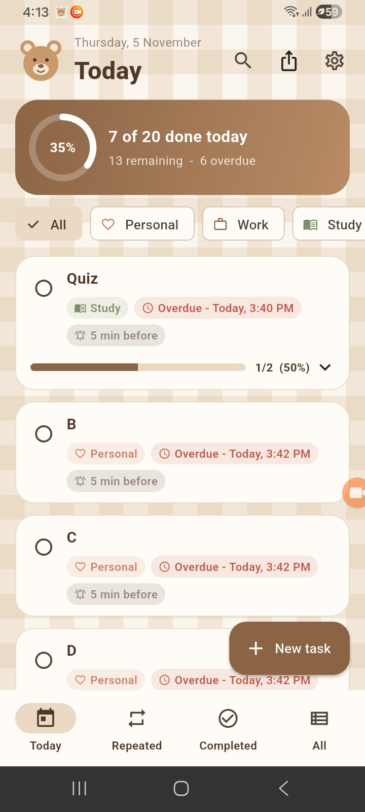
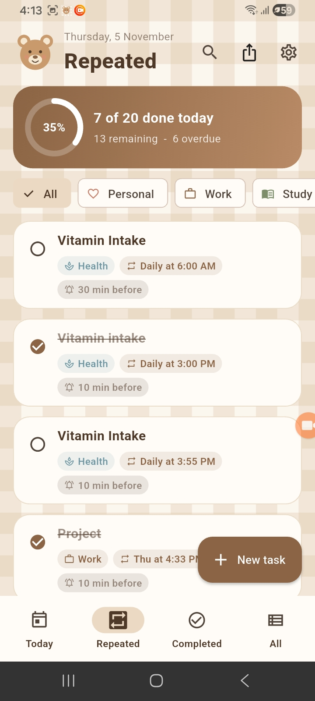
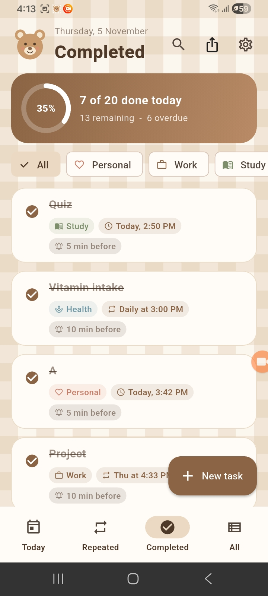
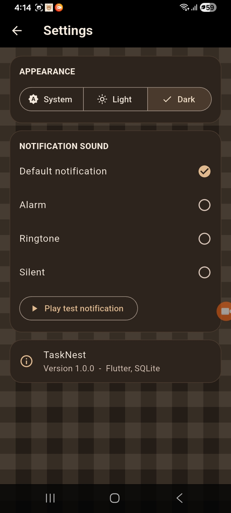

# TaskNest - Task Management App

TaskNest is a task management application built with **Flutter**. It stores all data locally in **SQLite**, supports repeating tasks, subtasks with progress tracking, category filters, data export (CSV, PDF, email) and local notifications. The interface uses a warm beige and brown teddy-bear theme with a gingham background and supports light and dark modes.

---

## Screenshots

| Today | New task | Repeated |
|---|---|---|
|  |  |  |

| Completed | Settings | Dark mode |
|---|---|---|
|  |  |  |

## Demo video

[Watch the demo video](https://drive.google.com/file/d/1PXDL6R2nLqUiPuBFJXC4WXsp2khpMkYg/view?usp=sharing)

## Download

The release APK is available in the [`release`](release/) folder (`app-release.apk`) or under the repository's **Releases** page.

---

## Features

### Task management
- **Add** a task with title, description, category, due date and time, and optional repeat settings.
- **Edit** any task by tapping it.
- **Delete** a task from the editor, or swipe it to the left. An **Undo** option appears after deleting.
- **Mark as completed** by tapping the circle on the task. Completed tasks move to the **Completed** view automatically.
- **Search** tasks by title or description.

### Views
| View | Shows |
|---|---|
| **Today** | Tasks due today, repeating tasks scheduled for today, and overdue tasks |
| **Repeated** | Tasks that repeat daily or on selected weekdays |
| **Completed** | Tasks that have been completed |
| **All** | Every task |

A summary card at the top shows today's progress, the number of remaining tasks and overdue tasks.

### Categories
Personal, Work, Study, Health and Other. Tasks can be filtered by category on every view.

### Repeating tasks
- Repeat **daily** or on **selected days of the week**.
- Completion status resets automatically each day, and so do the subtasks of a repeating task.

### Subtasks and progress tracking
- Add any number of subtasks to a task.
- Each task card shows a progress bar and percentage (for example `2/3 (66%)`).
- Completing all subtasks completes the task.

### Notifications
- A local notification at the task's due time.
- An optional **early reminder**: the user chooses how long before the task to be reminded (5, 10, 15, 30 minutes, 1 hour, 2 hours or 1 day). The default is **5 minutes before**, and it can be switched off.
- Works for one-time, daily and weekly tasks.
- Notifications show only the task title and a short line such as "Due in 5 min".

### Customization
- **Theme:** System, Light or Dark.
- **Notification sound:** Default, Alarm, Ringtone or Silent, with a test button.

### Export
Export all tasks as **CSV**, **PDF**, or share both files by **email** from the share menu.

---

## Technology

| Purpose | Package |
|---|---|
| Local database | `sqflite`, `path`, `path_provider` |
| Notifications | `flutter_local_notifications`, `timezone` |
| Preferences (theme, sound) | `shared_preferences` |
| Date formatting | `intl` |
| PDF export | `pdf` |
| Sharing files and email | `share_plus` |

## Database schema (SQLite, version 3)

```
tasks(id, title, description, category, due, repeat_type, repeat_days,
      done, last_done, reminder, sub_reset, remind_before)

subtasks(id, task_id, title, done)
```

`repeat_type`: 0 = none, 1 = daily, 2 = selected days. `remind_before` is the early reminder in minutes.
The database is upgraded automatically from older versions.

## Project structure

```
lib/main.dart        Application code (models, database, notifications, UI)
pubspec.yaml         Dependencies
android/             Android configuration (permissions, notification receivers)
release/             Release APK
screenshots/         Screenshots used in this README
```

---

## Setup

1. Install [Flutter](https://docs.flutter.dev/get-started/install) and Android Studio with the Android SDK.
2. Clone the repository:
   ```
   git clone https://github.com/kashafx007/task-manager-app.git
   cd task-manager-app
   ```
3. Install dependencies:
   ```
   flutter pub get
   ```
4. Connect an Android phone (USB debugging on) or start an emulator, then run:
   ```
   flutter run
   ```
5. Build the release APK:
   ```
   flutter build apk --release
   ```
   Output: `build/app/outputs/flutter-apk/app-release.apk`

### Android configuration for notifications
`android/app/src/main/AndroidManifest.xml` contains these permissions and receivers:
- `POST_NOTIFICATIONS`, `SCHEDULE_EXACT_ALARM`, `RECEIVE_BOOT_COMPLETED`, `VIBRATE`
- `ScheduledNotificationReceiver` and `ScheduledNotificationBootReceiver`

`android/app/build.gradle.kts` enables core library desugaring (`isCoreLibraryDesugaringEnabled = true`) and adds the `desugar_jdk_libs` dependency.

On Android 13 and above, allow the notification permission when the app first opens. On Android 12 and above, if reminders arrive late, turn on **Alarms & reminders** for the app in the phone's settings.

---

## User manual

1. **Add a task:** tap **New task**, enter a title, choose a category, set the schedule and optional subtasks, then tap **Add task**.
2. **Set a reminder:** in the Schedule section keep **Remind me** on and choose when to receive the early reminder.
3. **Repeat a task:** choose **Daily** or **Weekly days** and select the days.
4. **Complete a task:** tap the circle on the left of the task.
5. **Use subtasks:** tap the arrow on a task card to expand it, then tick the subtasks.
6. **Edit or delete:** tap a task to edit it. Use the trash icon, or swipe left, to delete. Tap **UNDO** to restore.
7. **Filter and search:** use the category chips under the summary card, or the search icon at the top.
8. **Export:** tap the share icon at the top and choose CSV, PDF or email.
9. **Settings:** tap the gear icon to change the theme and notification sound.

## Testing

| Test | Result |
|---|---|
| Add, edit, delete and undo delete | Passed |
| Mark complete and find the task in Completed | Passed |
| Daily and weekly repeat, automatic reset | Passed |
| Subtask progress persists after restart | Passed |
| Notification at due time and early reminder | Passed |
| Notification sound options | Passed |
| CSV and PDF export | Passed |
| Light and dark theme persist after restart | Passed |
| Layout on different screen sizes | Passed |

> Update this table with your own test results before submitting.

---

## Notes
- Notifications and export work on Android. When the app is opened in a web browser, data is stored in browser storage and these two features are unavailable.
- The app was developed as a Mobile Application Development course project.
